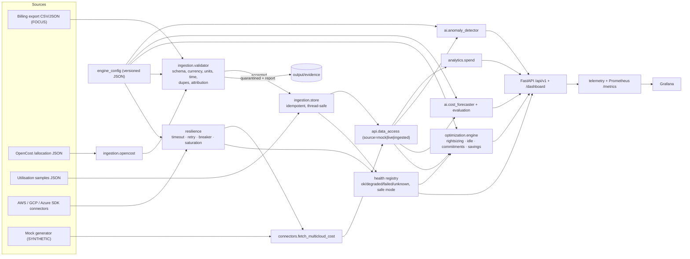

# Architecture (D1)

## Problem charter

Engineering and finance teams running workloads on AWS, GCP, Azure and Kubernetes need one
trustworthy place to answer five questions:

1. What did we spend?
2. Is anything abnormal?
3. Where is spend heading?
4. What can we safely save?
5. Can we trust these numbers right now?

"Trustworthy" is the core requirement. Bad billing data, missing telemetry and failing
dependencies must be visible, never silently absorbed.

## Scope and system boundary

| In scope (implemented) | Out of scope / not verified |
|---|---|
| Ingesting FOCUS-style billing exports (CSV/JSON) and exported OpenCost `/allocation` responses | Live calls to OpenCost/Kubecost servers |
| Existing AWS / GCP / Azure SDK connectors, unchanged but now wrapped in timeouts, retries and a circuit breaker | Running the connectors against real accounts (no authorisation) |
| Spend analytics, anomaly detection, forecasting, right-sizing, idle detection, commitments, savings ledger | Automatically applying any change to cloud resources (by design) |
| FastAPI service, built-in dashboard, Prometheus metrics, Grafana dashboard JSON | Multi-tenant auth beyond the single shared API key |
| Health, degraded and safe mode, recovery evidence, SLO reporting | Persistent storage (the ingestion store is in-memory per process) |

## Component view

## Data flow and contracts

1. **Ingestion** (`finops_engine/ingestion/`). Every row ends up in exactly one bucket:
   accepted, quarantined (with reasons) or duplicate. The batch report reconciles cost across
   the three buckets, records the SHA-256 of the input, the schema version and the config
   version, and is written to the evidence directory. Re-submitting identical bytes is a
   no-op.
2. **Dataset resolution** (`api/data_access.py`). `source=auto` keeps the original behaviour
   (mock or live per `FINOP_MOCK_MODE`). `mock`, `live` and `ingested` select explicitly.
   Live mode has no utilisation source, and the API says so instead of returning empty
   "no savings".
3. **Analytics** (`analytics/spend.py`). Trends and breakdowns are computed in UTC.
   Unattributed and conflicting attribution are shown explicitly.
4. **Anomaly detection** (`ai/anomaly_detector.py`, extended). An alert is raised only when
   all three hold: per-series IsolationForest flags the day, the rolling z-score is at least
   the threshold, and spend is at least 20% above the baseline (materiality gate). Every
   alert carries its evidence.
5. **Forecasting** (`ai/cost_forecaster.py`, extended). Linear trend with a t-based 95%
   prediction interval. `evaluation/forecast_eval.py` back-tests it against naive baselines.
6. **Optimisation** (`optimization/`). Right-sizing, idle detection and commitments, each
   with an explicit status (`actionable`, `requires_review`, `insufficient_data`,
   `rejected` or `suppressed`). The savings ledger separates estimated from realised savings
   and applies overlap controls.
7. **Reliability** (`resilience.py`, `health.py`, `telemetry.py`). Bounded calls to
   dependencies, a health registry with stale detection, safe mode, recovery events,
   latency and error SLOs.

## What was reused vs added

The FOCUS schema, connectors, mock generator, anomaly and forecast engines, FastAPI app,
API-key auth, CORS policy, Prometheus exporter, Docker/Compose/K8s/Terraform assets and all
76 original tests are reused unchanged or with additive edits. The new packages are
`ingestion`, `analytics`, `evaluation` and `optimization`, plus the modules `engine_config`,
`health`, `resilience`, `telemetry`, `api/data_access`, `api/routes_extended` and
`dashboard/index.html`. See `FINAL_IMPLEMENTATION_REPORT.md` §4.

## Key design decisions and trade-offs

| Decision | Why | Trade-off |
|---|---|---|
| No new runtime dependencies | Keeps the pinned stack and lockstep CI. Uploads read the raw body, so no `python-multipart`. The dashboard is vanilla JS + SVG with no CDN. | The dashboard is simpler than a SPA framework |
| In-memory ingestion store | The Community Edition has no database. The idempotency key is the input hash. | Data is lost on restart and not shared between processes. The Dockerfile therefore runs 1 worker (see limitations) |
| Materiality gate (≥20%) on anomalies | Rolling z on very stable series flags immaterial wiggles. Precision improved from 0.56 to 0.91 (dev) and from 0.50 to 1.00 (independent hold-out); config v2 (14-day baseline, z ≥ 3.0) raised dev to 1.00 with recall unchanged. | Spikes smaller than 20% are not alerted. The second day of a multi-day spike can be missed because the baseline absorbs day 1. |
| Detection-result TTL cache (5 min) | IsolationForest fitting takes about 1.5 s per call on 2 vCPU | Results can be up to 5 minutes old. Any data or config change misses the cache. |
| Timed-out dependency threads are abandoned, not killed | Python cannot kill threads safely | A hung SDK call holds one of 8 workers until it returns. Saturation is then rejected rather than queued. |
| Recommendations never act | Safety requirement | A human performs every change |
